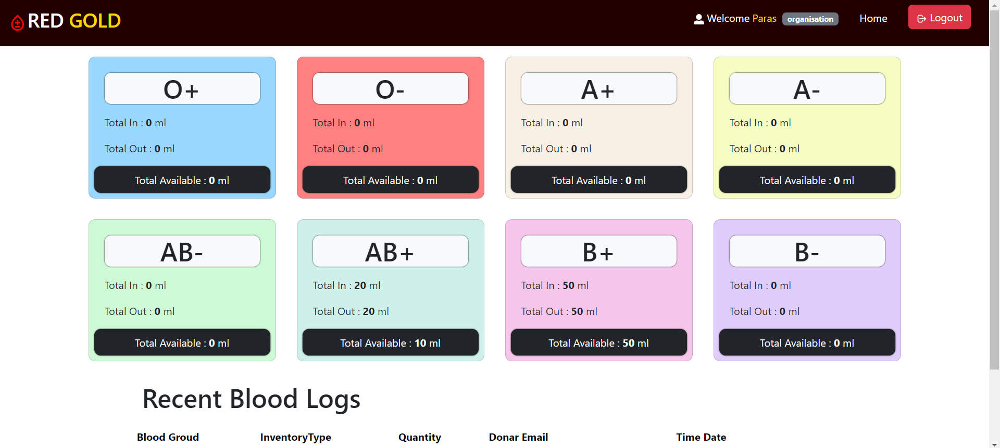
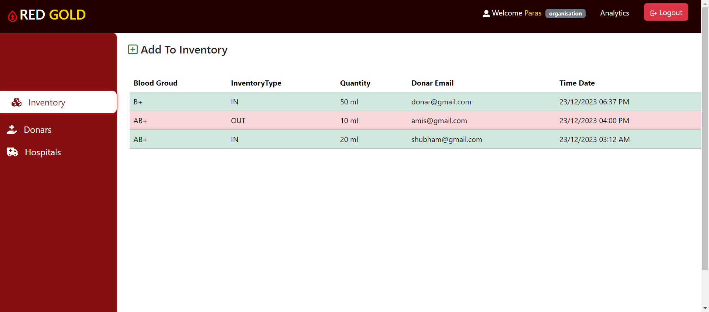

# Blood Bank (MERN)

A full stack blood bank management system built with **MongoDB, Express, React and Node.js**. Organisations, hospitals and donors each get their own dashboard to record donations, track blood stock by group, and see who donated or received blood. Admins can review and manage all users.

## Screenshots





## Features

- **Four roles**
  - **Organisation:** records blood coming in (donations) and going out (to hospitals), and sees live stock for all 8 blood groups.
  - **Donor:** sees their own donation history and the organisations they donated to.
  - **Hospital:** sees blood they received and the organisations they get it from.
  - **Admin:** views and manages donors, hospitals and organisations.
- **Authentication:** JWT tokens (1 day expiry), passwords hashed with bcrypt.
- **Stock validation:** a blood request is rejected if the organisation doesn't have enough of that group in stock.
- **Analytics:** per-blood-group totals (in / out / available).
- **Frontend:** React 18, React Router, Redux Toolkit, Axios, Bootstrap.
- **Backend:** Express with an MVC structure (`routes/`, `controllers/`, `models/`, `middleware/`), Mongoose for data modelling.

## Security notes

- Public registration only allows the `donar`, `hospital` and `organisation` roles. Admin accounts can't be created through the API (see below).
- Password hashes are never returned by the API.
- Which records a donor or hospital can read is decided on the server, not by filters sent from the browser.
- Errors returned to the client contain a short message only, never the raw error object.

## Tech stack

| Layer    | Tools |
|----------|-------|
| Frontend | React, Redux Toolkit, React Router, Axios, Bootstrap, react-hot-toast |
| Backend  | Node.js, Express, Mongoose, JWT, bcryptjs, Morgan, CORS |
| Database | MongoDB |

## Getting started

### Prerequisites

- Node.js 18+ and npm
- A MongoDB database (local, or a free MongoDB Atlas cluster)

### 1. Install

```bash
npm install            # backend
npm run client-install # frontend
```

### 2. Environment variables

Copy the example files and fill in your own values:

```bash
cp .env.example .env
cp client/.env.example client/.env
```

| File | Variable | Description |
|------|----------|-------------|
| `.env` | `MONGO_URL` | MongoDB connection string |
| `.env` | `JWT_SECRET` | Long random string used to sign tokens |
| `.env` | `PORT` | API port (default `8080`) |
| `.env` | `DEV_MODE` | `development` or `production` |
| `client/.env` | `REACT_APP_BASEURL` | API base URL, e.g. `http://localhost:8080/api/v1` |

Never commit your real `.env` files. They are listed in `.gitignore`.

### 3. Run

```bash
npm start
```

This starts the API on http://localhost:8080 and the React app on http://localhost:3000.

### 4. Create an admin (optional)

```bash
ADMIN_EMAIL=admin@example.com ADMIN_PASSWORD=aStrongPassword npm run create-admin
```

## API overview

All routes are prefixed with `/api/v1`. Routes marked 🔒 need an `Authorization: Bearer <token>` header.

| Method | Route | Description |
|--------|-------|-------------|
| POST | `/auth/register` | Register a donor, hospital or organisation |
| POST | `/auth/login` | Log in and receive a JWT |
| GET | `/auth/current-user` 🔒 | Get the logged-in user |
| POST | `/inventory/create-inventory` 🔒 | Add a blood record (in / out) |
| GET | `/inventory/get-inventory` 🔒 | Organisation's records |
| GET | `/inventory/get-recent-inventory` 🔒 | Last 3 records |
| POST | `/inventory/get-inventory-hospital` 🔒 | Records for the logged-in donor or hospital |
| GET | `/inventory/get-donars` `/get-hospitals` `/get-organisation` 🔒 | Related users |
| GET | `/analytics/bloodGroups-data` 🔒 | Stock per blood group |
| GET | `/admin/donar-list` `/hospital-list` `/org-list` 🔒 | Admin only |
| DELETE | `/admin/delete-donar/:id` 🔒 | Admin only |

## Project structure

```
├── client/          # React app
├── config/          # database connection
├── controllers/     # request handlers
├── middleware/      # auth and admin checks
├── models/          # Mongoose schemas
├── routes/          # Express routes
├── scripts/         # createAdmin.js
└── server.js
```

## Roadmap

- Input validation with a schema library
- Rate limiting and security headers (helmet)
- Automated tests
- Pagination for long record lists
